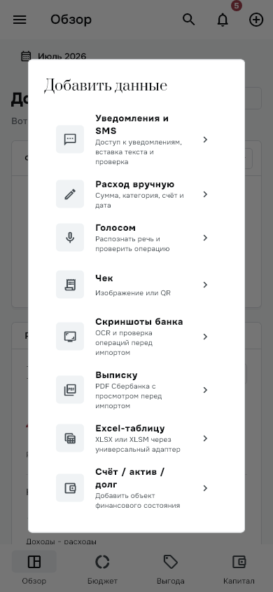
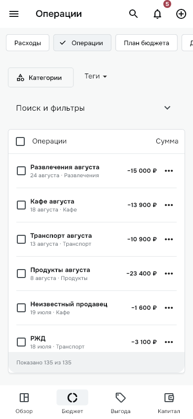
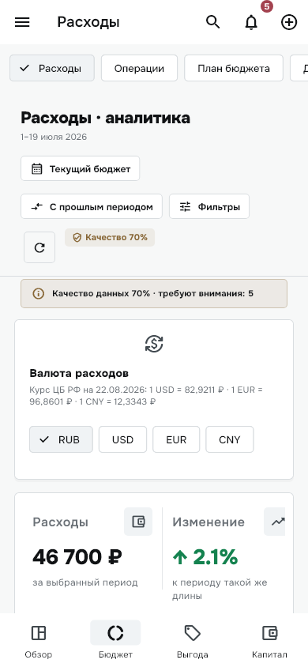
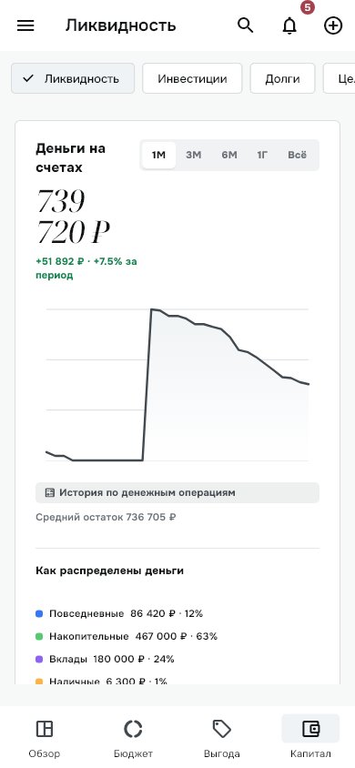
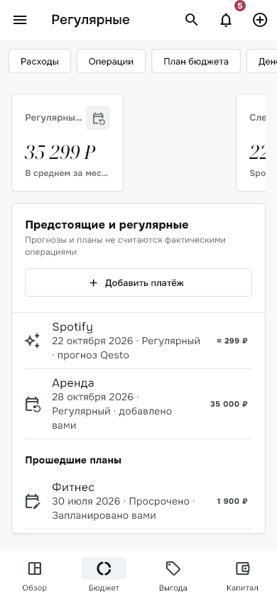
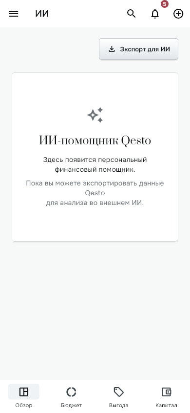

# Qesto Mobile — аудит и проектирование, этап 1

Дата: 4 октября 2026. Исходная версия: `1.0.64+65`, commit `4478c97`, ветка `codex/qesto-unified-analytics-drilldown-1.0.63`. Учтены текущие незакоммиченные изменения регулярных платежей, а не только HEAD.

**Статус: предложение для согласования. Реализация не начата.** Production-код, модели, финансовые значения, банковские профили и настройки не изменены. Добавлены только этот отчёт и диагностические изображения. APK не собирался и не устанавливался.

## Краткий вывод

Мобильная версия в текущем репозитории — уже не старая отдельная реализация. Она использует **тот же финансовый контроллер и почти все те же страницы, что desktop**, но в мобильной оболочке. Поэтому главный объём работ — не переписывание функциональности, а мобильная навигация, представление данных, единообразная детализация и проверка Android-интеграций.

Не нужно возвращать прежнюю мобильную структуру «Бюджет → Статистика → вложенные вкладки». Нужно создать мобильный presentation поверх существующих моделей и Synoball.

Рекомендуемый основной навигационный ряд: **Обзор / Операции / Бюджет / Капитал**. ИИ-экспорт, Выгода, источники, история, корзина и настройки остаются доступны через «Ещё» в верхнем меню, без пятой постоянной вкладки. Добавление — отдельное действие, не раздел.

## 0. Основания и границы проверки

Проверены текущие entry points, навигация, production-обработчики действий, состояния, Android channels и разрешения, хранение, источники данных, тема и тесты. Не делался вывод о функциональности по одному наличию файла.

Обозначения:

- **Код** — подтверждено действующими маршрутами/обработчиками.
- **Рендер** — подтверждено текущим Flutter widget-render на синтетических данных.
- **Риск** — следует из кода, но не воспроизведён на физическом устройстве.
- **Предложение** — новая организация UI, ещё не реализована.

Телефон и установленный на нём APK в этой проверке не участвовали. Нельзя по репозиторию утверждать, какая версия установлена на телефоне, что работают камера/системные разрешения/OCR/голос или что все формы удобны с клавиатурой. Живой UX-аудит Android и accessibility-проверка остаются отдельной частью device QA. Скриншоты ниже — **не снимки пользовательского профиля и не эмулятор установленного APK**.

Product Design использован для структурирования визуальной проверки; отсутствие live-device capture не скрыто. Предложения опираются на код и свежие диагностические рендеры, а не на старые скриншоты.

### Выполненные проверки

- `mobile_desktop_parity_test.dart`, `mobile_capital_forms_test.dart`, `tool/mobile_preview_test.dart`: **34 теста прошли**. Ширины 360/430, разделы и нижние блоки, меню добавления, создание четырёх типов финансовых объектов.
- Дополнительный временный диагностический renderer: **1 тест прошёл**, Android platform branch, 390×844, реальные Onest/Prata/Noto Serif Display, семь изображений текущего интерфейса.
- Исходный preview helper загружает старые шрифты; его изображения с отсутствующими глифами отклонены. Для отчёта использован новый диагностический рендер, не изменявший production.
- `flutter analyze --no-pub`: **No issues found** (76,7 с).
- Полный test run, release build, реальная синхронизация и device QA на этом исследовательском этапе не выполнялись; прежние результаты не выдаются за новые проверки.

## 1. Что сейчас представляет собой mobile

### 1.1. Действующая архитектура

```text
main.dart
  → QestoApp / MaterialApp / общая тема
  → загрузка LocalQestoRepository
  → QestoAppShell
      → один BudgetController / Synoball / сохранение
      → Android notification importer
      → desktop-only bank scheduler
      → DesktopAppShell
          ├─ ширина <900: AppBar + Drawer + chips + bottom navigation
          └─ ширина ≥900: sidebar + topbar
              → один _pageFor() → общие Desktop…Page
```

Источники: [app shell](../../lib/app/qesto_app_shell.dart), [presentation shell](../../lib/desktop/desktop_app_shell.dart), [destinations](../../lib/desktop/desktop_destination.dart).

Нет второго мобильного ledger. `BudgetController` восстанавливает canonical Synoball и строит read models; импорты, категоризация, правки, удаление и корзина проходят через общую систему. `StatisticsController` — общий аналитический контроллер. Капитал, долги, инвестиции, цели и предстоящие события используют существующие domain services.

Финансовое хранилище локальное, шифрованное, с восстановлением и защитой записи. Общее ядро **не означает автоматическую синхронизацию данных между ПК и телефоном**: такого production-сервера сейчас нет.

### 1.2. Что видно пользователю

- Нижняя панель: Обзор, Бюджет, Выгода, Капитал.
- В Бюджете: шесть горизонтальных chips — Расходы, Операции, План бюджета, Денежный поток, Ритм жизни, Регулярные.
- В Капитале: Ликвидность, Инвестиции, Долги, Цели.
- Drawer повторяет разделы, добавляет ИИ, настройки и историю действий.
- Верхняя панель содержит поиск, центр уведомлений/качества и меню добавления.
- Импорты и часть деталей — полноценные routes; другие детали — desktop overlay или локальное состояние страницы.

Сильные стороны: единые данные и вычисления, общий White Silver, компактные строки операций, lazy journal, рабочие shared редакторы, пустые состояния и retry. Это хорошая основа; менять финансовое ядро для новой навигации не требуется.

### 1.3. Legacy: удалять только после проверки достижимости

`BudgetScreen`, `BenefitsScreen`, `SavingsScreen`, `QestoBottomNavigation`, `StickyAppHeader` не являются текущими entry points приложения. Старые Budget/Statistics/Capital screens образуют старую ветку, а `DesktopAssistantPage` с локальным демонстрационным чатом не является действующим ИИ-разделом.

Но `features/` целиком не legacy: `CategoryDetailsScreen`, `TransactionDetailsScreen`, import screens, классификация, история, редакторы, statistics sections/controller активно используются. В enum остаются `accounts/merchants/categories`, однако отдельные пункты не показываются в основной навигации; часть доступна через поиск/детализацию. Их нельзя считать тремя новыми обязательными мобильными вкладками.

README местами описывает старые «Накопления», статистику и шрифты; актуальная спецификация должна опираться на production graph, не на этот текст.

## 2. Desktop → Mobile gap analysis

Статус «есть» означает наличие маршрута и обработчиков в коде, **не полную device-проверку**. A — сохранить общий механизм; B — адаптировать mobile presentation; C — объединить точки входа; D — обоснованно desktop-only.

| Возможность desktop | Текущее mobile: действия и ограничения | Статус | Решение |
|---|---|---|---|
| Обзор и финансовые KPI | Период, переключение показателей, капитал/расходы/поток, последние операции, локальное обновление есть | Есть; громоздко | B: короткая сводка → подробности |
| Графики Обзора | Tap дня/недели и узлов потока, раскрытие, scoped операции есть | Есть; windows/panels не mobile-first | A+B: route детализации, сохранить точную выборку |
| Топ расходов / бюджет категорий / ближайшие события | Открытие продавца/категории/всего списка, переход в план и регулярные есть | Есть | B: короткие previews с явным «Все» |
| Аналитика расходов | Период, сравнение, фильтры, quality review, графики, RUB/USD/EUR/CNY, category/merchant детали | Есть; плотные toolbars/KPI | B: summary + список; фильтры sheet |
| Категория и продавец | Динамика, полный список операций, категоризация и tracking; merchant-кнопка «Создать правило» пока только SnackBar | Есть; одна кнопка-placeholder | C+B: внутри аналитики; рабочие правила через изменение категории операции, без ложного merchant-action |
| Ритм жизни | Аналитика дней/недель/циклов, переходы в операции | Есть | C: дополнительный аналитический экран |
| Операции | Чтение, поиск, category/account/source/tag/review filters, scoped IDs, selection | Есть | B: основной мобильный журнал |
| Детали / правка операции | Поля доступны через несколько редакторов: desktop panel и shared detail/editor | Частично единообразно | A+B: одна mobile detail route + edit |
| Категоризация и правила | Категория/подкатегория/теги, scope «эта / похожие / всегда», пользовательские правила | Есть | A+B: переиспользовать сохранение и подтверждение scope |
| Массовая правка / удаление | Выбор ID, категории/теги/удаление | Есть | B: отдельный selection mode |
| «Требуют внимания» | Причины, badge, фильтр, карточки, исправление | Есть; разрозненные входы | C+B: одна очередь проверки |
| Корзина | Поиск, восстановление отдельной/всех операций, retry | Есть | A+B: экран, confirm destructive actions |
| История действий | Список, undo, переход в корзину | Есть | A: вторичный экран |
| План бюджета | Период, общий лимит, category limits, цвет/icon/name | Есть | B: budget landing → лимит/категория |
| Cash Flow | Income/expenses/net/норма, диапазон месяцев, privacy, river, источники/категории, drill-down | Есть | B: цифры и breakdown сначала; полная река отдельно |
| Ликвидность | Общая история, распределение, резерв, прогноз, состояние данных | Есть; chart hover-only | B: touch chart и доступный список значений |
| Счета | Список/hidden, создание, detail, role/preferences/reserve flags | Есть; overlay details | B: счёт как route; не добавлять отсутствующий account delete |
| Подушка | Выбор reserve accounts, цель/месяцы/сумма | Есть | A+B: компактная настройка из Капитала |
| Инвестиции | Create/edit/archive, valuation snapshots, contributions, period/history | Есть | B: portfolio → объект → действие |
| Долги | Create/edit/archive, чтение snapshots/payments, detail, условия и расчёты сценариев; отдельного payment CRUD UI нет | Есть в этих границах | B: list → debt → условия/history/edit/расчёт |
| Цели | Create/edit/archive, detail, contributions/allocations/history/темп/сценарии | Есть | A+B: сохранить рабочую goal model |
| Предстоящие / регулярные | Ручные события, inferred recurring, debt events; create/edit/delete manual, source debt | Есть; KPI790px | C+B: единый список событий; не считать прогноз фактом |
| Ручное добавление | Create expense, дата/категория/счёт/merchant/comment; отдельного create income/transfer нет | Есть для расхода | A+B; не обещать новые типы ввода как перенос desktop |
| Голос | Android on-device speech → parser → confirmation → Synoball | Есть код; зависит от устройства | A+B + native QA |
| Чек / QR | Android barcode scanner/manual QR; OCR обогащает распознанный QR-чек | Есть; не произвольный photo-only importer | A+B: явные этапы и fallback |
| Скриншоты банка | Android picker/OCR, preview/review, canonical import | Есть код | A+B + native QA |
| Выписка PDF/TXT | Native picker/extraction, shared parser, preview/import | Есть код | A+B + native QA |
| Excel XLSX/XLSM | Native picker, универсальный адаптер, preview/source identity | Есть код | A+B + большие файлы/отмена |
| Уведомления/SMS | Capture и canonical drain есть; enable-permission CTA отсутствует | Частично | A+B: источник/разрешения/очередь |
| Вставка текста уведомления | Пункт меню обещает её; фактического UI во входящих нет | Отсутствует обещанный flow | Реализовать как восстановление заявленного сценария после согласования |
| ИИ | Рабочий JSON Export v2 Compact/Diagnostic, native save; помощник пока placeholder | Есть экспорт, нет assistant | C+B: «Экспорт для ИИ» в «Ещё» |
| Выгода | Первые 6 offers и tracked-product cards, без активных detail/activation/CRUD в действующей странице | Ограничение общее, не mobile-only | C+B: сохранить read-only; не добавлять продукт за рамками переноса |
| Настройки | Профиль, аватар, валюта, appearance, курсы/retry, category/tag manager, корзина | Есть | A+B: список настроек → конкретная настройка |
| Глобальный поиск | До 6 операций / 4 destinations, desktop dialog; не универсальный поиск всех сущностей | Есть ограниченный | B: mobile search page; тот же набор данных |
| CEF/PIN/DEV/фоновая банковская sync | На Android исключены platform guard | Отсутствует намеренно | D: существующий CEF desktop runtime; отдельная задача для mobile bank integration |

### Общие ограничения — не выдавать за потерянные мобильные функции

В главном журнале нет собственного независимого date/type filter: аналитика передаёт scoped IDs. Ручной create сейчас expense-only и whole-currency amount. В «Выгоде» нет действующего CRUD отслеживания/активации. ИИ-чат не работает. Кнопка «Создать правило» на merchant detail показывает только SnackBar; рабочее сохранение правила есть через изменение категории операции со scope для прошлых и будущих, а управление — в category manager. `addDebtPayment` существует в controller, но production UI его не вызывает: долги используют payment data и редактирование условий/баланса, не отдельный editor платежа. Не нужно молча «достраивать» эти функции в UI-миграции; если они нужны, это отдельный согласованный scope.

## 3. Что действительно надо перенести/восстановить

### 3.1. Перенести desktop действия в нормальный mobile flow

1. Один экран операции с доступом ко всем существующим полям, классификации, правилам, review/delete/restore.
2. Exact drill-down из всех аналитических блоков с исходным периодом, выбранными IDs и возвратом обратно.
3. Все существующие filter/period/privacy/сравнение controls, но не в нескольких плотных toolbar.
4. Полные формы капитала, цели, долга и инвестиции — с клавиатурой и доступным сохранением.
5. События manual/inferred/debt в едином списке, с существующими create/edit/delete и переходом к source.
6. Все import previews/review/confirm/retry/cancel, а не только пункты меню.
7. Настройки категории/тега/правила, история/корзина, JSON export — с понятными вторичными входами.

Это перенос доступности и качества presentation, а не создание новых financial engines.

### 3.2. Функциональные пробелы / дефекты, найденные в коде

**P1 — разрешения уведомлений.** Есть `NotificationCaptureService.openSettings()` и Android handler, но вызовов из `lib` нет. При отсутствии доступа входящие получают `captureAvailable:false` и пустое/unavailable состояние вместо объяснения и кнопки подключения. Нужен CTA, проверка после возврата из настроек и состояния denied/enabled/unavailable. [Service](../../lib/features/notification_import/data/notification_capture_service.dart), [inbox](../../lib/features/notification_import/presentation/notification_import_screen.dart).

**P1 — финансовая семантика при исправлении уведомления.** Inbox строит draft дохода/возврата/перевода, затем открывает `AddExpenseScreen(addInitialAsNew:true)`; сохранение этого пути вызывает `controller.addExpense`. По коду возможна подмена исходного типа расходом; суммы с копейками не могут использовать «Изменить». Это **не подтверждённый эффект на текущем профиле**, а конкретное расхождение обработчиков. Нужна отдельная согласованная safety-правка общего intake с regression cases для всех типов/копеек. Не использовать эту ветку как основу нового универсального редактора до проверки. [Inbox](../../lib/features/notification_import/presentation/notification_import_screen.dart), [editor](../../lib/features/budget/add_expense_screen.dart).

**P2 — привязка capability к ширине.** Native inbox callback применяется только при `<900`; Android tablet/large window получает `captureAvailable:false`. Это capability платформы, не layout. Также новое глобальное добавление не должно скрывать inbox только из-за размера окна. [Shell](../../lib/desktop/desktop_app_shell.dart).

**P2 — обещание вставки текста.** Подпись меню не соответствует текущим controls. Либо восстановить обещанный путь через существующий canonical adapter, либо убрать обещание до его реализации; решение фиксируется отдельно.

**P2 — «Счёт / актив / долг».** Этот пункт сейчас переводит в Ликвидность, не запускает редактор и не позволяет выбрать тип. Новый action picker должен непосредственно открывать уже существующие editors. Это не новая сущность.

## 4. Проблемы текущей information architecture

| Проблема | Наблюдение / последствие | Предлагаемое изменение |
|---|---|---|
| Тройная навигация | Bottom + drawer + chips для одних страниц; бюджетные chips не помещаются | Четыре корня + обычные списки/детали, без section-chip rail |
| Ложное активное состояние | На ИИ/Настройках bottom выделяет Обзор, т.к. `section == null` | Вторичные routes поверх источника, не фиктивный root |
| Неодинаковый Back | `_select`/account/transaction/debt/investment detail меняют state без Navigator history | Единый route/back contract |
| Сброс точки возврата | Корень Бюджета всегда landing Expenses; Capital → Liquidity | Сохранить root scroll/фильтры/период и место возврата |
| Неясный scope | Overview/Statistics/Cash Flow/Capital имеют разные честные периоды, Operations scoped IDs отдельно | Всегда видимая подпись scope; не выдавать trailing months за месяц бюджета |
| Analytics слишком рано | Toolbar/quality/currency/KPI занимают экран до графика и списка | Summary → breakdown → details |
| Детализация как desktop window | Overlay/expanded tool не системная мобильная route | Full-screen detail/analysis route |
| Нет главного входа в журнал | Операции спрятаны внутри бюджета | Операции — постоянный корень |
| Равноправная Выгода | Занимает 1/4 bottom nav при read-only limited content | Вторичный раздел; функцию не удалять |
| Системный шум | Profile/settings/history/AI разбросаны по drawer/пунктам | Единый secondary menu |

`QestoExpandableTool` использует OverlayPortal/barrier/Escape, без route/PopScope. Из этого следует риск Android Back, но не следует, что все расширения уже воспроизводимо ломаются на телефоне. Детали счетов дополнительно используют full MediaQuery width внутри уже padded Stack — риск обрезания, требующий device/render проверки.

## 5. Предлагаемая mobile architecture

### 5.1. Карта экранов

```text
Qesto Mobile
├─ Обзор [нижняя панель]
│  ├─ период + короткая финансовая сводка
│  ├─ динамика расходов → день/неделя → scoped операции → операция
│  ├─ структура → категория / продавец → операции → операция
│  ├─ денежный поток → breakdown → полный график
│  ├─ требуют внимания → очередь → исправление
│  └─ ближайшие события → событие / существующий source
├─ Операции [нижняя панель]
│  ├─ журнал + поиск + активные фильтры
│  ├─ фильтры [sheet] / scope из аналитики
│  ├─ операция → редактирование / категория и правило / удаление
│  ├─ режим выбора → существующие массовые действия
│  └─ очередь проверки / корзина [переходы]
├─ Бюджет [нижняя панель]
│  ├─ план периода → общий лимит → категорийный лимит
│  ├─ расходы → категории / продавцы → детали → операции
│  ├─ поток и ритм → подробная аналитика
│  └─ предстоящие и регулярные → событие → редактор / источник долга
├─ Капитал [нижняя панель]
│  ├─ общий итог / ликвидность → история и распределение
│  ├─ счета → счёт → preferences / reserve settings
│  ├─ подушка → существующая цель / настройка резерва
│  ├─ инвестиции → объект → оценка / взнос / edit / archive
│  ├─ долги → долг → история/условия / edit / расчёт сценария
│  └─ цели → цель → взнос / allocation / history / edit / archive
├─ Ещё [верхнее меню, не постоянная пятая вкладка]
│  ├─ источники и входящие → доступ к уведомлениям / статус / review
│  ├─ Выгода [существующее read-only представление]
│  ├─ Экспорт для ИИ → Compact / Diagnostic → сохранить JSON
│  ├─ категории, теги и правила
│  ├─ история действий / корзина
│  └─ настройки → профиль / валюта / appearance / курсы
└─ Добавить [+ как действие]
   ├─ расход вручную / голос → проверка → сохранить
   ├─ чек/QR / скриншоты → scan/picker → preview → import
   ├─ выписка / Excel → picker → preview → import
   ├─ уведомления/SMS → источник / входящие
   └─ финансовый объект → счёт / инвестиция / долг / цель [existing editors]
```

Капитал не получает четыре chips внутри chips: landing показывает сводку и ссылки на сущности. Бюджет — не скрытая копия Обзора: его главный смысл план и управление; подробная аналитика доступна ссылками.

### 5.2. Правила навигации

1. Корневые разделы — устойчивые места, детали — реальные routes. Вложенный раздел не требует дополнительной полосы tabs.
2. Back: sheet/dialog → закрыть; entity detail → исходный list; analytic drill-down → тот же график/выбор; root → штатное Android поведение, без скрытого перебора вкладок.
3. Переключение корня сохраняет UI-состояние своего корня. Не сохранять всю тяжёлую desktop page tree постоянно только ради scroll.
4. Cross-link передаёт ID объекта, period/scope и return origin. Не выбирать операции повторно по приблизительному merchant label.
5. Unsaved editor: Back спрашивает о потере ввода. После успешного save возвращает к тому же объекту, без второго финансового контроллера.
6. Поиск — mobile route, период/фильтры/sort/scope выбора категории — sheet. Длинные import reviews и capital editors — полноэкранные flows.
7. Отменённый picker или import не меняет canonical state. Progress/retry/cancel доступны без выхода из приложения.
8. «Обновить аналитику» остаётся local projection refresh, не обещает bank sync. Статус источника показывается отдельно.

### 5.3. Граница архитектуры в коде

```text
lib/
├─ app/                         # общий lifetime данных и capability wiring
├─ mobile/                      # новый presentation/navigation, после approval
│  ├─ mobile_app_shell.dart
│  ├─ navigation/               # routes, Back, return scope, UI state
│  ├─ pages/                    # overview / operations / budget / capital / more
│  └─ widgets/                  # scaffold, touch rows, filter sheets
├─ features/                    # existing domain, editors, imports, controllers
├─ data/                        # existing models / repository / persistence
├─ synoball/                    # existing canonical pipeline
├─ design_system/               # общие White Silver tokens и компоненты
└─ desktop/                     # desktop presentation сохраняется
```

Mobile navigation state — только UI: текущий route, filters, scroll, selection. Это не второй финансовый source of truth. Не добавлять второй repository, budget engine или мобильные копии моделей.

Presentation view data, которые сейчас живут под `desktop/overview`, можно извлекать в нейтральное shared место **только при реальном использовании обеими сторонами**, с неизменными результатами. Отдельные financial calculations не нужны. Новый routing package и UI framework не требуются; начать с существующего Navigator.

## 6. Основные UX-решения

| Сохраняем | Адаптируем / заменяем |
|---|---|
| canonical операции, типы и internal-transfer semantics | один mobile editor вместо нескольких desktop panels |
| exact analytics scopes / данные категорий и продавцов | summary → detail route → операции |
| фильтры, сравнение, валюты, privacy | mobile sheets и читаемые scope labels |
| бюджеты, цели, allocations, snapshots, debt projections | короткие lists + entity action screens |
| факт / ручной план / прогноз / debt event как разные сущности | разные подписи и источники в одном списке событий |
| complete import preview и подтверждение | touch review, доступный progress/cancel |
| корзина и undo | отдельный recovery flow, не соседство destructive с primary |
| существующие read-only Выгода и export | secondary entries, без имитации новых функций |

Река денег не теряет категории и суммы: compact summary и список групп ведут к тому же полному breakdown. Полный canvas может быть отдельным экраном, но его данные должны также быть доступны списком для touch/screen reader. Не делать пустую иллюстрацию вместо интерактивной аналитики.

## 7. Design alignment

Использовать текущие `qesto_tokens.dart`, `qesto_semantic_colors.dart`, `qesto_theme_data.dart`, `qesto_silver.dart`. Сохранить White Silver surfaces/borders, финансовые emerald/burgundy, category colors, light/dark/system theme.

Текущая типографика: **Onest** — UI, **Prata** — важные заголовки, **Noto Serif Display italic** — финансовые hero values; технические/числовые стили через существующие typography tokens. Не возвращать устаревшие шрифты из старого README и не импортировать новые зависимости ради mobile.

### Переиспользуемые части

- `QestoWindow` / `QestoCard`, silver controls, semantic colors и `QestoHeroMoney`.
- existing loading/empty/error/retry, status/freshness модели.
- compact transaction rows, shared classification actions и canonical save methods.
- chart view data, period services, transaction drill-down selectors.
- существующие native adapters и формы полей после отделения presentation.

### Что создать/выделить первым

`MobilePageScaffold`, `FinancialSummary`, `TransactionListItem`, `QualityNotice`, `SourceStatus`, `PeriodPicker`, `FilterSheet`, `ActiveFilters`, `EntityActionSheet`, mobile editor host. Если аналог уже общий — использовать его, а не добавлять второй.

Compact/medium/expanded должны зависеть от constraints контейнера. Проверять 320/360/390/430, landscape и tablet отдельно; breakpoint не определяет доступность native сервиса. Mobile поля обычно16, между группами24; данные и длинные названия допускают перенос. Основные touch zones48 logical px, даже когда иконка визуально18–24. Общую desktop density не менять ради mobile.

Все charts: tap/scrub selection + явная дата/сумма + доступная альтернативная таблица/список. У Overview и Cash Flow tap уже есть; активный `_BalanceChart` ликвидности сейчас только hover. Canvas labels сами по себе не обеспечивают accessibility отдельных точек. Screen reader, контраст и Android predictive Back требуют отдельной проверки, не декларации соответствия WCAG.

Серебряный материал сохраняется, но desktop оконные expansion affordances не становятся универсальным способом mobile-навигации. Full-screen аналитика должна вести себя как обычный экран.

## 8. План реализации после согласования

| Slice | Что входит | Граница завершения |
|---|---|---|
| 1. Mobile foundation | отдельный shell, четыре корня/Ещё/+, route/back contract; common theme и capability wiring; временные adapters старых pages | существующие функции доступны, Desktop не изменён, route/back tests, no model changes |
| 2. Операции и источники | list/detail/edit, quality queue, selection, корзина; Add flow и native permission onboarding, импорт review/cancel | полный вертикальный сценарий и exact return scope; native smoke на телефоне |
| 3. Обзор и Бюджет | компактная сводка, план/лимиты, expenses/category/merchant/cashflow/rhythm drill-down, touch charts | суммы/выборки совпадают с desktop на одном fixture, никаких UI-only финансовых расчётов |
| 4. Капитал и события | accounts/reserve/investment/debt/goal mobile routes/forms, upcoming/recurring/debt events | CRUD существующих механизмов, no duplicate records, keyboard/back tests |
| 5. Вторичные flows | settings/курсы/rules/history, read-only Benefits, AI export, state/freshness consistency | нет недоступных existing actions и ложных обещаний |
| 6. Cleanup и release QA | удалить только подтверждённый dead subtree; документы; полный analyze/tests, release APK, device regression | signed update поверх прежней установки без uninstall/data loss |

**Отдельный prerequisite к slice2:** согласовать и исправить описанную ветку pending-notification → expense, с тестами сохранения исходного типа/направления/копеек. Это обнаруженная safety-задача общего intake, не косметический mobile redesign. Не исправлялась в этом аудите и не должна раствориться в большом UI diff.

Каждый slice — обозримый PR/набор коммитов, после него приложение запускается. Не делать один огромный rewrite. Не повышать version/build и не устанавливать APK во время Stage1.

### Первый технический PR

`feat(mobile): introduce approved mobile navigation shell`

В нём: новый mobile shell и route contract, существующие страницы через adapters, сохранение root UI state, capability не по ширине, tests Back/scope/доступности действий. Shared `QestoAppShell`, `BudgetController`, Synoball, repository, расчёты и схемы storage не изменять. Один демонстрационный detail route операции показывает схему, но полный editor migration — следующий slice.

Нет оснований для data migration ради этой архитектуры. Если необходимость модели обнаружится позже, остановиться и согласовать её отдельно.

## 9. Состояния и verification plan

| Состояние | Принцип для новой mobile версии |
|---|---|
| Loading | existing skeleton; не подменять существующие суммы нулями |
| Empty | причина + релевантное действие; импорт/создать план/добавить счёт |
| Populated | реальная иерархия, lazy длинные lists, exact totals |
| Error | объяснение и retry; финансовые данные не стираются |
| Partial | предупреждение о неполноте; «получено частично» не выдавать за нулевой баланс |
| Offline | локальный ledger доступен; network-dependent flow объясняет ограничение |
| Stale | last updated/source status; local refresh не обозначать банковской синхронизацией |
| Large data | тысячи операций/много событий; сохранить виртуализацию; профилировать, а не предполагать |
| Long text / huge/zero amounts | перенос, деньги без обрезания, text scale, ноль/нет данных/нет плана различаются |
| Missing optional fields | явные placeholders «не определено», не выдуманные identity/category |
| Permission denied/unavailable | подключить/объяснить/повторно проверить; не скрытый пустой inbox |
| Keyboard / safe areas | поля и Save доступны; scroll, insets, отмена и unsaved Back |

### Android / platform границы

- NotificationListener собирает сообщения нативно, но canonical import выполняется при startup/resume или событии, пока Flutter жив. Inbox ограничен100 записями/7 днями. Это не непрерывный фоновый financial worker.
- SMS — текст SMS-уведомлений, не чтение SMS database/history: `READ_SMS/RECEIVE_SMS` не заявлены. OTP/секреты исключаются capture policy.
- Android voice требует поддерживаемого on-device recognizer/языка; недоступность должна быть явной.
- OCR чека сейчас QR-first enrichment; arbitrary image-only item ingestion и FNS fetch не реализованы.
- CEF, банковский PIN/DEV, desktop background Sber sync остаются desktop-only. Не заменять их в этой миграции WebView с обещанием паритета.
- `SynoballApiV1` — in-process Dart interface, Open Banking runtime не live integration. Финансового server sync нет.
- Public Benefits provider отличается на Android/desktop; это public feed, не финансовая синхронизация. Provider не менять заодно с UI.
- iOS папка существует, но equivalent native channels отсутствуют. Этот план ориентирован на **Android**; iOS потребует отдельного scope.

### Обязательная QA после реализации

1. На одном dataset desktop/mobile totals, cashflow/internal transfers/categories/liquidity/goal/debt projections одинаковы.
2. Navigation tests: каждый корень, secondary menu, entity route, exact graph selection, Back, deep cross-link, root-state retention.
3. UI tests: 320–430, landscape/tablet, textScale1.3–2.0, long labels, large sums, keyboard insets, safe areas, empty/partial/error.
4. Android device: file/camera/scanner/speech/export, permission deny→grant→resume, picker cancel, inbox drain/duplicate/retry, копейки и разные transaction types.
5. Persistence: signed update поверх прежней версии, приложение перезапускается без потери ключа/данных; не менять `applicationId=ru.qesto.qesto` и signing key; не использовать uninstall как способ обновления.
6. Большая история: lazy journal, аналитика и detail lists не блокируют UI; проверить профилированием.
7. Full analyze/tests/release APK; показать фактически выполненные device сценарии и оставшиеся ограничения.

## 10. Основные риски и решения для согласования

- **Общий shell:** mobile refactor может повредить Desktop. Отделить presentation без изменения lifetime/controllers; desktop regression обязательна.
- **Scope/read models:** повторный расчёт выборки в detail может дать другое число. Использовать existing selectors/canonical IDs и сохранять origin.
- **Изменение pending notification:** описанная финансовая семантика требует отдельной safety-проверки, не просто новой формы.
- **Capability vs viewport:** wide Android не desktop по сервисам. Layout и платформенные возможности независимы.
- **Persisted data:** schema/signature/key changes опаснее нового UI. В плане нет migration, new backend или second state.
- **Legacy dependencies:** file names не доказывают dead code. Удаление только после замены и usage graph.
- **Нативный host:** большой `MainActivity.kt` объединяет много bridges; не переписывать его ради nav, проверить lifecycle каждого adapter.
- **Synthetic tests:** successful render не доказывает touch/back/permission/native flow. Это baseline, а не Android certification.
- **Выгода и ИИ:** secondary placement не удаление функциональности; assistant/tracking CRUD не объявлять реализованными.
- **Полные charts:** доступный list fallback обязателен; сокращение экрана не должно уничтожать финансовый смысл.
- **Обновление телефона:** без server sync данные ПК сами не появятся на телефоне. Если нужен перенос данных/синхронизация устройств, отдельная задача, не скрытый подпункт redesign.

На согласование: четыре корня **Обзор / Операции / Бюджет / Капитал**, «Ещё» в верхнем меню, persistent Add action; Android как первый целевой mobile runtime; CEF desktop-only; сохранение limited Benefits/AI export, без новых продуктовых функций; отдельная safety-правка pending-notification.

## 11. Свежие визуальные проверки: семь шагов

Изображения получены в этой сессии из текущего кода, проверены после сохранения. Синтетический sample ledger, 390×844, Android target, реальные production fonts. Это диагностический render flow, **не live UX-аудит телефона**.

| Шаг | Экран / общее состояние | Наблюдение |
|---|---|---|
| 1 | Обзор — данные видны, но первый экран перегружен KPI | Первая крупная карточка капитала почти полностью занимает полезную высоту; аналитика и действия ниже |
| 2 | Добавление — все8 existing entry actions доступны | Длинный modal; подпись обещает text paste, которого в inbox нет; direct entity action отсутствует |
| 3 | Операции — компактный journal работает | Верхняя полоска budget destinations сохраняется и занимает место; последующие пункты за экраном |
| 4 | Расходы — controls есть, плотность высокая | Period/comparison/filter/quality/currency занимают верх; KPI остаётся горизонтальной областью |
| 5 | Ликвидность — данные/график видны | Крупная сумма переносится; много secondary controls; chart touch information отсутствует по handler коду |
| 6 | Регулярные — список работает, summary неудобен | Карточки KPI разделены широкой полосой790px; часть показателей вне viewport |
| 7 | ИИ — экспорт доступен, assistant отсутствует | Placeholder честно говорит о будущем помощнике; bottom nav ошибочно подсвечивает Обзор |

### 1. Обзор


### 2. Добавить данные



### 3. Операции



### 4. Расходы



### 5. Ликвидность



### 6. Регулярные



### 7. ИИ-экспорт



## 12. Evidence index

Ключевые production места (номера строк на дату аудита):

- `app/qesto_app.dart:48,157` — MaterialApp/theme и initial load/error.
- `app/qesto_app_shell.dart:53,81,131,159` — один controller, notification lifetime, доступ, platform bank guard.
- `desktop/desktop_app_shell.dart:112,185,244,300,334,400,479,582,642,745` — breakpoint, текущая nav, shared pages, state selection, Add/capability.
- `desktop/pages/desktop_transactions_page.dart:248,327,355,866` — lazy list, state detail, filters, compact row.
- `desktop/pages/desktop_accounts_page.dart:125,142,504,563,1461,1911` — details, constrained overlay risk, активный hover chart/period controls.
- `desktop/pages/desktop_recurring_page.dart:96,220` — fixed horizontal KPIs и event list.
- `desktop/pages/desktop_support_pages.dart:144,1991,2240,2291,2327` — goal editor, actual AI export route, read-only Benefits.
- `design_system/qesto_expandable_tool.dart:65` — overlay expansion, без Android route.
- `features/notification_import/data/notification_capture_service.dart:86` — unused settings action.
- `features/notification_import/presentation/notification_import_screen.dart:52,347,548` — no-access state, edit draft path, fractional edit restriction.
- `features/budget/add_expense_screen.dart:159` — new draft expense save path.
- `features/budget/state/budget_controller.dart:148,469,511` — restore/merge/read model refresh; intake points754/950/1605/1697/1820/1918/1944.
- `android/app/src/main/kotlin/ru/qesto/qesto/MainActivity.kt:115,263` — settings and native speech; `NotificationInbox.kt:23` — retention.
- `data/persistence/android_store_location.dart:9`, `encrypted_local_key_value_store.dart:37` — existing private encrypted storage.
- `android/app/build.gradle.kts:40` — application/signing boundary.

## 13. Stop point

Stage1 заканчивается здесь. Не сделаны новый shell, cleanup legacy, финансовая safety-правка, model migration, APK или установка. Подтверждение IA и границ нужно **до** Stage2.

Следующее действие: согласовать предложенную навигацию и slices; затем начинать первый небольшой mobile foundation PR.
